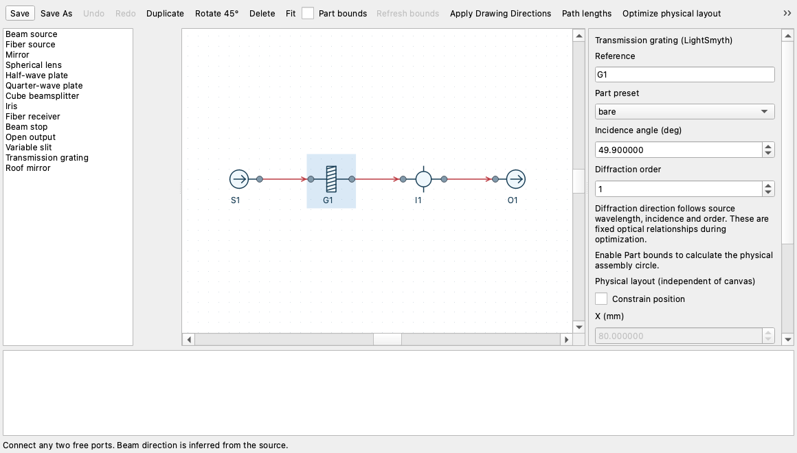

# Lab catalog in the schematic editor

Drag a symbol from the palette and select its **Part preset** in the inspector.
Mounts and adapters belong to the optical assembly, so the same selection is
used for Python export, Part bounds, and physical optimization.
New beam and fiber sources default to **1550 nm**, as does `BeamPath` in Python.
An explicitly selected wavelength is preserved.

Each optical pass defaults to **Centered hit**. The physical solver, packing,
validation and Python export require its intersection at the nominal interaction
center, rather than accepting any point inside the aperture. Select the pass and
uncheck **Centered hit** for an intentional off-center interaction. Shared return
examples explicitly disable centering on their displaced lens and waveplate
passes; clear-aperture checks remain active. Roofs center the entrance port and
preserve the designed displacement of the exit.



| Symbol | Added presets | Parameters |
|---|---|---|
| Mirror | POLARIS-K05VS2, POLARIS-K1VS2, MHV-12.7L-R, MHV-25.4L-R | Optic thickness; diameter fixed by mount |
| Spherical lens | POLARIS-L05G, POLARIS-L1G | Focal length, optic thickness; diameter fixed by mount |
| Half/quarter-wave plate | FBR, ELL16 with HOM holder | Thickness, fast axis; diameter 12.7 mm |
| Fiber source/receiver | POLARIS-K05T6, KA05TA | F260FC-1550 + AD1109F + selected mount |
| Cube beamsplitter | Displacement PBS + integral seat | Reflected polarization axis; 12.7 mm cube |
| Iris | Fixed alignment iris | Aperture diameter |
| Variable slit | VA100 with bracket and hardware | Slit width, 0–6 mm |
| Transmission grating | LightSmyth 1336552, bare or MK05S + plate adapter | Incidence angle, integer diffraction order |
| Roof mirror | HRS1015-P01, horizontal/vertical, bare or supported | Beam separation, 3–22 mm |

Existing presets retain their previous behavior. A mount selection fixes optic
diameter, and incompatible thicknesses produce an export diagnostic. Switching
presets removes parameters that do not belong to the new selection, as one
undoable edit. Standalone mechanical mounts and the XR25C translation stage
remain in the CAD catalog; they have no optical interaction to insert in a beam
route.

Source symbols now expose **Linear polarization (deg)**. A PBS reflects the
selected linear polarization and transmits its orthogonal polarization, using
the catalog's ideal coating model. Its default reflected axis is 45°, so the
default source produces both branches. A source aligned exactly with one PBS
axis can extinguish a branch; the generated runtime trace check will report a
required branch that receives no light. Existing nonpolarizing cube presets
retain their reflected-power setting.

## Gratings and roof mirrors

The grating's outgoing direction follows source wavelength, incidence angle,
and diffraction order. The incidence angle is a hard constraint relative to
the incoming beam: free downstream components move to meet the diffracted ray,
while position, beam-length and mirror-turn pins remain enforced.
Select the grating and enable **Mirrored orientation** to send diffraction to
the other side of the incident beam. This keeps the same incidence angle and
diffraction order, turns the real assembly in XY with its mount upright, and
repositions free downstream optics. A/B propagation remains reversible in
either orientation; the selection is saved and included in generated Python/CAD.
Unsupported nonpropagating/grazing orders block export
and optimization with a diagnostic. The optimizer preserves this optical
relationship. A/B connections remain reversible. The model is the catalog's
ideal single-order thin grating; it does not add substrate displacement or
calibrated diffraction efficiency.

A roof mirror has two distinct optical ports. Its physical position is the
resolved entrance origin; the return beam leaves the displaced exit and turns
180°. The horizontal preset offsets the return beam sideways. The vertical
preset changes its height; exported downstream components follow that height.
Reversing A/B reverses the offset. Beam lengths measure the external legs
between actual ports. Total-path constraints also include the actual internal air path between finite roof facets (25.4 mm for nominal axial incidence). The ray solver and native export share the same roof-facet math. Add explicit return passes to the existing lens or waveplate to reuse those parts; a pickoff must also be wired explicitly.

Packing uses XY assembly disks, including for vertical roofs. It remains a
conservative planar packing check; differing heights do not exempt disks or
beams from XY clearance tests. The canvas uses the same physical coordinates and millimetre scale. XY and XZ projections show the same shared parts.

## Vendor CAD sources

The pinned STEP/PDF sources are now [included in Git](../PyOpticL/catalog_data/sources/README.md)
under `PyOpticL/catalog_data/sources`. A complete checkout works offline without
a personal CAD cache. Verify every bundled source with:

```sh
python -m PyOpticL.vendor_cad verify --all
```

The resolver checks repository bytes first. Missing files can fall back to
`~/.cache/pyopticl/cad` or `PYOPTICL_CAD_CACHE`; corrupt repository files fail hash
verification. Restore missing bundled files from Git before retrying. Explicit
`--cache` selects an external store for registration or individual verification.

If a file is missing, download the exact part's STEP from its official product
page and register it against the existing manifest, for example:

```sh
python -m PyOpticL.vendor_cad register --vendor thorlabs \
  --part HRS1015-P01 --product-url https://www.thorlabs.com/item/HRS1015-P01 \
  --document-id TTN048987-E0W --kind step \
  --file /absolute/path/HRS1015-P01-Step.step \
  --manifest PyOpticL/catalog_data/assets/HRS1015-P01.step.json
```

The command refuses to replace a catalog pin with a different hash. A revised
download requires separate datum verification. See the repository's
[vendor CAD workflow](../skills/vendor-optics-cad/SKILL.md). After restoring the
sources, use **Refresh bounds** in the schematic editor. Editing and portable
Python export work without CAD; displaying bounds, optimizing, and building
the exported CAD require the selected parts' complete geometry.

## Examples and verification

[Editable examples and their Python exports](../Designs/schematics/catalog/)
cover the new mount selections, a grating chain, and a roof return. Regenerate
them with `python Designs/schematics/catalog/generate.py`.

Portable and Qt coverage is in `tests/test_schematic_catalog*.py`, alongside the
existing schematic tests. Inside FreeCAD, run `tests/schematic_catalog_freecad.py`
with the `tests` directory on `sys.path`. Its per-preset tests report missing
vendor assets as explicit skips. The original `tests/schematic_freecad.py`
full-preset bounds test remains strict and fails until every asset is present.

The [native catalog report](../Designs/schematics/catalog/native-verification.json)
records historical coverage before the sources were bundled: real
grating/PBS/iris checks passed, while vendor-dependent tests were skipped because
the cache was absent. The roof
interface check uses real FreeCAD ray propagation with an explicitly analytical
body fixture; it verifies finite interfaces and path lengths, not purchased
geometry or assembly bounds.
